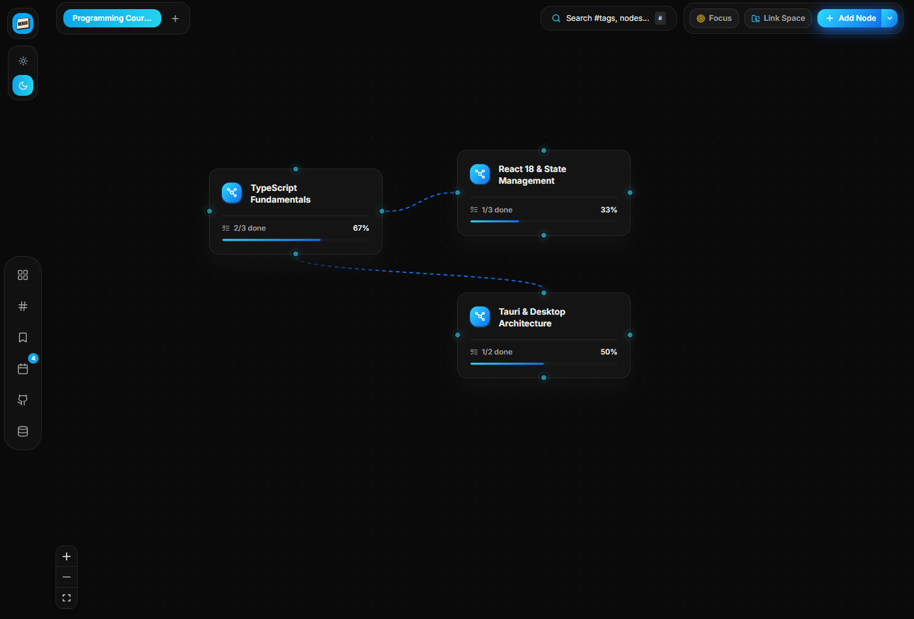
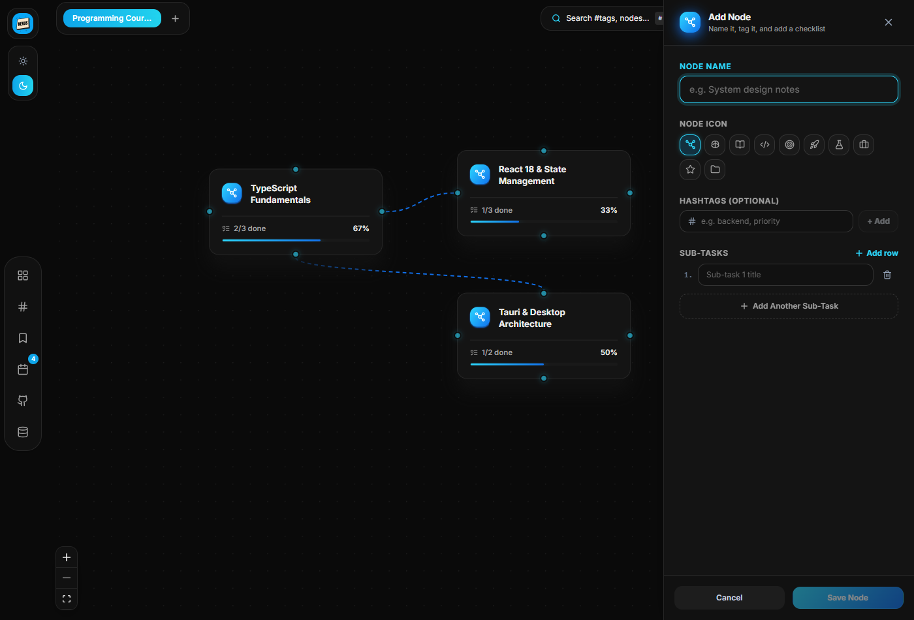
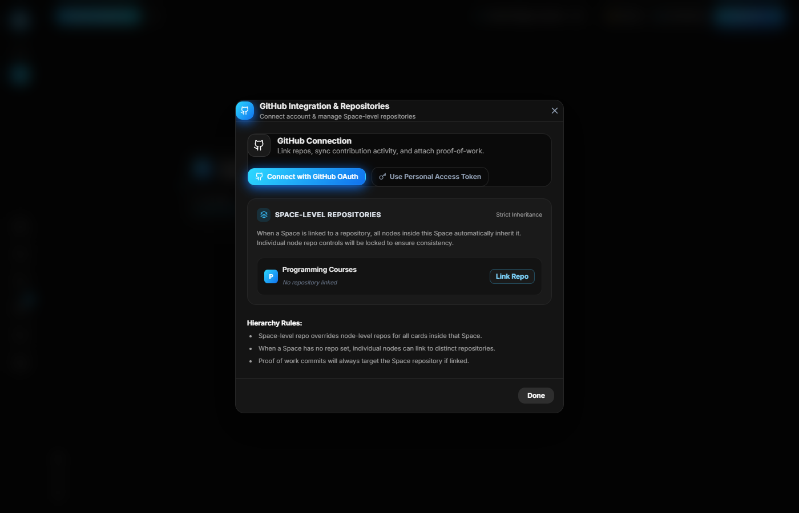
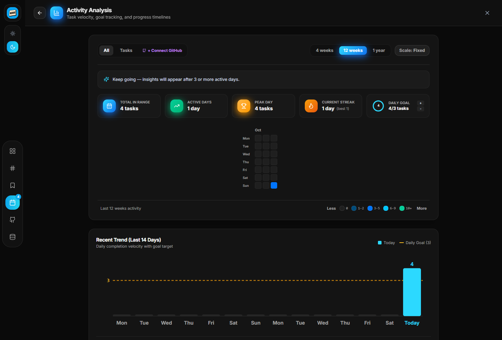
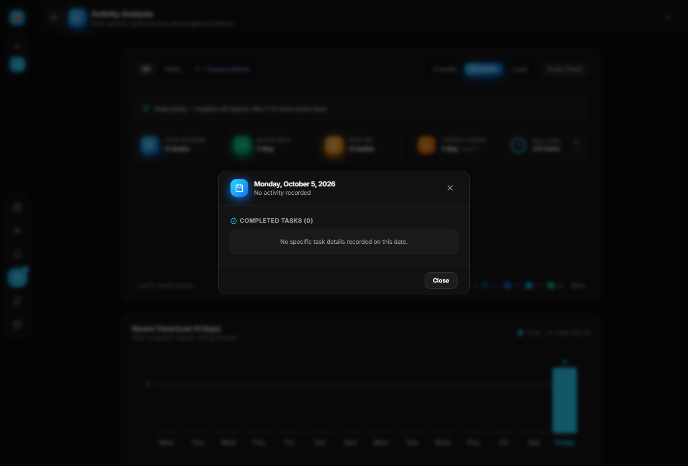
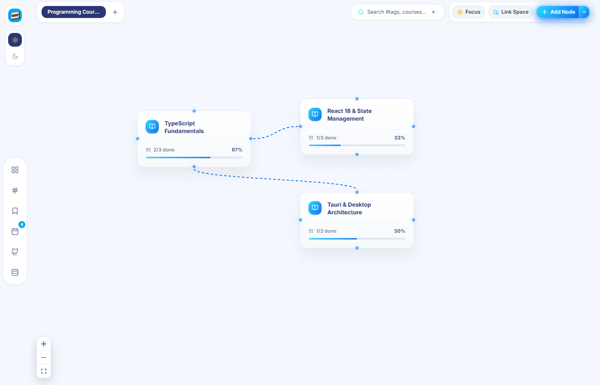

<div align="center">

# 🪐 NEXUS

### Knowledge Connected · Visual Curriculum Orchestration & Performance Tracking

[](https://tauri.app/)
[](https://react.dev/)
[](https://www.typescriptlang.org/)
[](https://www.rust-lang.org/)
[](https://www.sqlite.org/)
[](LICENSE)

<br />

**NEXUS** is an offline-first desktop application designed for software engineers, technical researchers, and self-directed learners who think in dependency graphs rather than flat checklists.

Instead of fragmenting complex subjects across disjointed to-do apps, NEXUS models technical domains as **interactive, linked node networks** with deep GitHub repository integration and granular activity metrics.

<br />



<br />

[Key Features](#-key-features) • [SpaceLink Architecture](#-spacelink-architecture) • [Activity Analysis](#-activity-analysis--heatmaps) • [Tech Stack](#-tech-stack) • [Getting Started](#-getting-started) • [Architecture](#-architecture--design-decisions)

</div>

---

## 💡 Why NEXUS?

Technical mastery is inherently non-linear:
- Learning *Distributed Systems* requires *Networking* and *Operating Systems* as explicit prerequisites.
- A foundational skill (e.g. *TypeScript Generics*) belongs in a *Language Fundamentals* workspace, but simultaneously serves as a prerequisite across multiple separate project roadmaps.
- Theory without committed code creates an illusion of competence.

Traditional productivity tools force this multi-dimensional knowledge into flat, linear to-do lists that fail to reflect dependencies. **NEXUS solves this by providing a unified canvas where knowledge nodes, prerequisites, sub-task checklists, and actual GitHub commits live in harmony.**

---

## 🚀 Key Features

### 🌌 Visual Learning Graphs (Infinite Canvas)
- **Node-Graph Workflow:** Create nodes with custom icons (graph, brain, code, target, flask, rocket, and more), hashtags, descriptions, and nested checklists.
- **Dependency Ports:** Connect source and target handles across 4 directions (`Top`, `Right`, `Bottom`, `Left`) to express prerequisites, milestones, and learning paths.
- **Focus Targets:** Designate any node as an active "Focus Target" to spotlight high-priority objectives and dim ambient canvas noise.
- **Embedded Notes & External Links:** Attach rich markdown notes, external documentation references, and links to any sub-task.

<div align="center">
  
  
</div>

### 🔗 SpaceLink Architecture & Cross-Space Projection
- **Single Source of Truth:** Reference a node from *Space A* inside *Space B* via a `SpaceLinkNode`. Checking off tasks from the link immediately updates the source node in SQLite without data duplication.
- **Bidirectional Traceability:** Target nodes display backlink badges indicating which other spaces reference them.
- **"Jump to Source" Navigation:** Teleport across workspaces with automated camera pan and smooth zoom directly to the targeted coordinates.
- **Circular Dependency Guard:** Graph traversal engine detects and blocks circular references (`Space A → Space B → Space A`).
- **Cascade Cleanup:** Deleting a space or node automatically cascades and removes all dependent `SpaceLink` references, preventing broken states.

---

### 📊 Activity Analysis & Heatmaps



- **Single Unified Activity Dashboard:** Combines local checklist achievements and live GitHub commits with a dedicated source filter (`All | Tasks | GitHub`).
- **Smart Time Ranges:** Switch between `4 weeks`, `12 weeks` (default, with 18px readable tiles), and `1 year`.
- **Smart Start:** If you have sparse history, the grid automatically begins at your first active week with a 1–2 week buffer instead of rendering a mostly empty year.
- **Day Detail Inspector:** Click any cell (or navigate via keyboard arrow keys) to open an inspection popover showing completed tasks, parent nodes, workspaces, timestamps, and commit hashes.
- **Streaks & Daily Goals:** Real-time streak tracking (current streak, longest streak, days since last active) and a daily goal progress ring.
- **Dynamic Scale Modes:** Toggle between `Fixed` thresholds (`0 | 1-2 | 3-5 | 6-9 | 10+`) and `Goal-Relative` thresholds (`0 | <50% | 50-99% | 100% | >100%`).
- **14-Day Velocity Trend:** Bar chart featuring daily output against your target goal line and week-over-week velocity comparison (`+50%`).
- **Workspace Distribution ("Where your time went"):** Visual distribution of time spent across workspaces; clicking any workspace filters the heatmap and stats dynamically.

<br />

<div align="center">
  
</div>

---

### 🐙 Hierarchical GitHub Integration
- **Strict Repo Inheritance:** Link an entire workspace to a GitHub repository, automatically cascading repo settings to all child nodes.
- **Standalone Node Overrides:** If a workspace is unlinked, individual nodes can link to distinct repositories.
- **Proof of Work Attachments:** Attach commit hashes and direct GitHub commit URLs as verified completion proofs to checklist items.
- **Live Syncing:** OAuth device flow and Personal Access Token (PAT) support with local SQLite commit caching.

### 🎨 Developer-Centric Neutral Dark Design
- **Engineered Color Palette:** Built with pure neutral grays (`#0a0a0a`, `#111111`, `#141414`, `#1a1a1a`, `#262626`) inspired by GitHub Dark and Vercel. Zero blue tint.
- **Argon Floating Shell:** Ergonomic floating rail, top-bar pills, and modal dialogs that maximize canvas workspace.
- **Zero Startup Flash:** Window background and HTML body pre-styled to prevent white flashes on boot.
- **Light Theme Intact:** Complete high-contrast light theme switchable via top-rail toggle.

<div align="center">
  
</div>

### 🔒 Offline-First & Data Sovereignty
- **Local SQLite Engine:** Data stored in a local SQLite database (`roadmap.db`) with native foreign-key constraints enabled.
- **Portable Backups:** Complete JSON import and export for backup and multi-machine sync.
- **Obsidian Vault Export:** Export entire workspaces into Markdown files formatted for Obsidian knowledge bases.

---

## 🛠️ Tech Stack

| Layer | Technologies |
| :--- | :--- |
| **Desktop Runtime** | [Tauri 2](https://tauri.app/) (Rust-based system IPC, lightweight memory footprint) |
| **Frontend Framework** | [React 18](https://react.dev/), [TypeScript 5.7](https://www.typescriptlang.org/) |
| **Graph & Canvas** | [@xyflow/react](https://reactflow.dev/) (React Flow v12) |
| **State Management** | [Zustand 5](https://github.com/pmndrs/zustand) (Modular stores with optimistic updates) |
| **Styling & Design** | [Tailwind CSS 3](https://tailwindcss.com/), [Lucide React](https://lucide.dev/) |
| **Storage & Persistence** | SQLite via [`@tauri-apps/plugin-sql`](https://github.com/tauri-apps/plugins-workspace) + LocalStorage fallback |
| **Date Utilities** | [date-fns v4](https://date-fns.org/) |
| **Bundler** | [Vite 6](https://vitejs.dev/) |

---

## 📂 Project Structure

```text
StudyApp/
├── docs/
│   └── screenshots/            # High-resolution application screenshots
├── src/
│   ├── components/
│   │   ├── AddCoursePanel/     # Node creation modal with icon picker & checklist
│   │   ├── Analysis/           # Analysis panel, 14-day trend bar, space breakdown, day inspector
│   │   ├── Canvas/             # React Flow canvas, CourseNode, SpaceLinkNode, TextNode
│   │   ├── CourseDetailPanel/  # Resizable slide-over panel for checklist & repo links
│   │   ├── GitHub/             # GitHub authentication, repo linking, proof of work badges
│   │   ├── Heatmap/            # ContributionHeatmap SVG grid with keyboard navigation
│   │   ├── Icons/              # NodeIcons registry and custom SVGs (NodeGraphIcon, BrainIcon)
│   │   ├── Navigation/         # SideRail and TopPillBar floating shells
│   │   ├── Sidebar/            # Spaces flyout and folder management
│   │   └── UI/                 # Argon design system components (Button, Input, Card, Badge)
│   ├── db/
│   │   └── client.ts           # SQLite plugin wrapper, migrations, and LocalStorage browser fallback
│   ├── store/                  # Zustand stores (useCanvasStore, useSpaceStore, useActivityStore, etc.)
│   ├── theme/                  # Argon theme tokens and dark/light color palettes
│   ├── utils/                  # activityUtils, spaceLinkUtils, repoResolver, obsidianExport
│   └── App.tsx                 # Root application wrapper and panel router
├── src-tauri/
│   ├── src/
│   │   ├── lib.rs              # Rust entry point and native HTTP IPC curl commands
│   │   └── main.rs             # Tauri application bootstrap
│   ├── capabilities/           # Security and SQL plugin permission manifests
│   ├── Cargo.toml              # Rust dependencies and release build profiles
│   └── tauri.conf.json         # Tauri window geometry, security CSP, and bundle configuration
├── package.json
├── tailwind.config.js
└── vite.config.ts
```

---

## ⚡ Getting Started

### Prerequisites

Ensure you have the following installed on your system:
- **Node.js**: v18.0.0 or higher
- **Rust & Cargo**: Latest stable toolchain (`rustup default stable`)
- **Platform Dependencies**:
  - **Windows**: Microsoft Visual Studio C++ Build Tools & WebView2
  - **macOS**: Xcode Command Line Tools
  - **Linux**: `libwebkit2gtk-4.1-dev`, `build-essential`, `curl`, `wget`, `file`, `libssl-dev`, `libgtk-3-dev`, `libayatana-appindicator3-dev`, `librsvg2-dev`

### Installation

1. **Clone the repository:**
   ```bash
   git clone https://github.com/ahmed-hafez-eg/NEXUS.git
   cd NEXUS
   ```

2. **Install frontend dependencies:**
   ```bash
   npm install
   ```

3. **Start the development server:**
   ```bash
   # Run frontend in browser dev mode (with in-memory SQLite fallback)
   npm run dev

   # Run as native desktop application
   npm run tauri dev
   ```

---

## 📦 Building for Production

To compile optimized release binaries and native platform installers:

```bash
# 1. Compile TypeScript and build production web assets
npm run build

# 2. Package standalone desktop application and installers
npm run tauri build
```

Compiled artifacts will be located in:
- **Windows Executable**: `src-tauri/target/release/nexus.exe`
- **Windows Installer**: `src-tauri/target/release/bundle/nsis/NEXUS_1.0.0_x64-setup.exe`
- **MSI Installer**: `src-tauri/target/release/bundle/msi/NEXUS_1.0.0_x64_en-US.msi`

---

## ⌨️ Keyboard Shortcuts

| Shortcut | Action |
| :--- | :--- |
| <kbd>Ctrl</kbd> + <kbd>K</kbd> | Open Hashtag & Node Search dialog |
| <kbd>Esc</kbd> | Close active slide-over panel / modal dialog |
| <kbd>Arrow Keys</kbd> | Navigate between days in the Activity Heatmap |
| <kbd>Enter</kbd> / <kbd>Space</kbd> | Open day details popover for focused heatmap day |
| <kbd>Delete</kbd> / <kbd>Backspace</kbd> | Delete selected node or connection line (with confirmation) |

---

## 🏛️ Architecture & Design Decisions

### 1. Cascade Deletions & Graph Integrity
Foreign keys are strictly enforced in SQLite via `PRAGMA foreign_keys = ON;`. Deleting a workspace automatically purges dependent nodes, sections, connections, and cross-space links. Graph consistency checks clean up dangling edges on startup.

### 2. Timezone-Safe Activity Aggregation
Activity dates are formatted and aggregated using the user's local timezone (`yyyy-MM-dd`) rather than UTC timestamps. This eliminates the midnight day-shift bug common in activity tracking applications.

### 3. High-Performance Decoupled Heatmap Tooltip
The heatmap utilizes floating DOM references for cell hover tooltips. Updating coordinates and label text bypasses React component tree re-rendering, maintaining 60 FPS performance when panning across year-long activity grids.

---

## 📄 License

This project is licensed under the **MIT License** — see the [LICENSE](LICENSE) file for details.

<div align="center">
<sub>Built with precision by <a href="https://github.com/ahmed-hafez-eg">Ahmed Hafez</a>.</sub>
</div>
